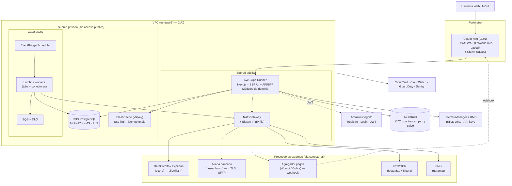

# Arquitectura AWS — Fintech de crédito para emprendedores

> **Opción B · AWS lean-secure (producto real, día 1)**
> Objetivo: seguridad al mil + AWS-native + costo contenido y escalable.
> Base: lo mejor de Plurall (Next.js + Postgres + RLS) + el patrón de **conectores** de la fintech real (Movii/Repo).
> Estado: diseño de referencia (F0 — levantamiento). Fecha: 2026-10-23.

---

## 1. Decisiones de arquitectura

| Decisión | Elección | Por qué |
|---|---|---|
| Nube | **AWS** (us-east-1) | Control total, exigencia de aliados bancarios, narrativa producción |
| Cómputo app | **AWS App Runner** (contenedor Next.js) | HTTPS + autoscaling + HA **gestionados**. Sin EC2 que parchar, sin ALB que operar |
| Base de datos | **RDS PostgreSQL Multi-AZ** (o Aurora Serverless v2) | Fuente única de verdad, transaccional, **RLS nativa** |
| Auth | **Cognito** (o Supabase Auth) | $0 bajo 10k MAU; emite JWT → RLS |
| Async / jobs | **EventBridge + Lambda + SQS (+DLQ)** | Cron de mora, débito automático, desembolso, conciliación con reintentos |
| Documentos | **S3** cifrado (SSE-KMS) + lifecycle a Glacier | KYC, contratos, paz y salvo; retención 5 años (RN-15) |
| Caché / rate-limit | **ElastiCache (Valkey)** *(opcional MVP)* | Idempotencia, rate limiting, sesiones |
| Perímetro | **CloudFront + AWS WAF** (o Cloudflare delante) | CDN + OWASP + rate-based + DDoS |
| Integraciones | **Anti-Corruption Layer** (1 conector por proveedor) | Aísla Experian, banco, pagos, KYC, FNG |
| Egreso a banco/bureau | **NAT Gateway + Elastic IP (IP fija)** | Allowlist que exigen DataCrédito/Experian y el aliado bancario |
| Secretos / certificados | **Secrets Manager + KMS + ACM** | mTLS, API keys, rotación |

**Principios:** costo marginal no fijo · dominio desacoplado de infraestructura (portable) · Postgres como verdad transaccional · idempotencia y trazabilidad en todo flujo de dinero · defensa en profundidad (authz en app **y** en DB vía RLS).

---

## 2. Diagrama de referencia



**Fallback ASCII:**
```
Usuarios → CloudFront+WAF → App Runner (Next.js SSR+BFF) ──┐
                 │                                          ├─ RDS Postgres (Multi-AZ, RLS, KMS)
            Cognito (JWT)                                   ├─ ElastiCache (Valkey)
                                                            ├─ S3 (KYC/contratos, SSE-KMS)
   EventBridge → Lambda workers → SQS/DLQ ─────────────────┤
                                                            └─ NAT GW + Elastic IP (IP fija)
                                                                     │
                      Conectores → Experian · Banco(mTLS/SFTP) · Pagos · KYC · FNG
```

---

## 3. Red y seguridad ("al mil")

**VPC** con 2 zonas de disponibilidad:
- **Subred pública:** App Runner (vía VPC Connector) y NAT Gateway. Nada más.
- **Subred privada:** RDS y ElastiCache **sin IP pública**; Lambda workers. Solo alcanzables desde Security Groups específicos.

**Controles obligatorios:**
- 🔒 **Security Groups least-privilege** — RDS acepta tráfico solo del SG de App Runner y del SG de Lambda; nada de `0.0.0.0/0`.
- 🔒 **KMS (CMK)** cifrando RDS, S3, ElastiCache y Secrets. Cifrado en reposo total.
- 🔒 **TLS en todo tránsito** (CloudFront → App Runner → RDS con `sslmode=require`).
- 🔒 **Secrets Manager** para credenciales, API keys y **certificados mTLS**; con rotación.
- 🔒 **AWS WAF** en CloudFront: reglas OWASP core + rate-based (anti fuerza bruta, RNF-01) + geo si aplica.
- 🔒 **RLS nativa de Postgres** atada al JWT (`SET LOCAL request.jwt.claims`) → aislamiento por rol/cliente a nivel de fila. Defensa en profundidad: authz en app **y** en DB.
- 🔒 **VPC Endpoints** (S3, Secrets Manager, ECR) → el tráfico a servicios AWS **no pasa por NAT** (más barato y más seguro).
- 🔒 **Acceso administrativo vía SSM Session Manager** — sin bastión, sin puertos SSH abiertos.
- 🔒 **CloudTrail** (auditoría de toda llamada API) + **GuardDuty** (detección de amenazas) + **CloudWatch Alarms**.
- 🔒 **Backups:** RDS automated + PITR; S3 versioning + lifecycle a Glacier (retención legal 5 años).

**El NAT Gateway aquí NO es desperdicio:** da la **IP de salida fija** que DataCrédito/Experian y el aliado bancario exigen allowlistear. Es el costo justificado de las integraciones.

---

## 4. Anti-Corruption Layer — integraciones (Experian, banco, etc.)

Cada proveedor vive detrás de **su propio conector** (módulo `lib/conectores/<proveedor>`), que traduce sus rarezas al dominio limpio. Patrón tomado de la fintech real (`credit-tangelo-connector`, `credit-payment-connector`, `credit-guarantee-fund-fng`…), pero como módulos, no como 40 Lambdas.

| Conector | Proveedor (Colombia) | Requisitos de integración | Dónde corre |
|---|---|---|---|
| `experian` | **DataCrédito / Experian** (score, Acierta) | Contrato + **IP allowlist** + API key | Lambda (vía NAT/EIP) |
| `bureau-alt` | TransUnion / CIFIN | Contrato + allowlist | Lambda |
| `pagos` | **Wompi / Cobre / ePayco** (recaudo) | API key + **webhook firmado (HMAC)** idempotente | BFF + webhook |
| `desembolso` | **Aliado bancario** / Transfiya / agregador | **mTLS** o **SFTP batch** + allowlist | Lambda (vía NAT/EIP) |
| `kyc` | **MetaMap / Truora** | API key + callback | BFF |
| `fng` | **Fondo Nacional de Garantías** | Convenio + API | Lambda |

**Reglas transversales de los conectores:**
- **Idempotencia** por clave externa (evita doble desembolso / doble pago — RN-12, RNF-10).
- **Reintentos con backoff** vía SQS + **DLQ** para fallos.
- **Timeouts y circuit breaker** por proveedor.
- **Conciliación** (payment-order pivot del Repo): registrar orden → esperar confirmación → conciliar contra cuota.
- Certificados **mTLS** y llaves en Secrets Manager, nunca en código.
- Si un conector debe aislarse/escalar solo, se despliega como su propia Lambda/servicio sin tocar el dominio.

> ⚠️ **Lo que decide A vs B no es Experian, es el contrato del aliado bancario.** Si exige VPN site-to-site o SFTP dedicado, B ya lo soporta nativo (Transfer Family para SFTP **saliente** desde Lambda evita el costo del endpoint hosteado; VPN con Site-to-Site VPN ~$36/mes solo si lo piden).

---

## 5. Capa asíncrona — procesos de dinero

`EventBridge Scheduler` dispara, `Lambda` ejecuta, `SQS` desacopla y reintenta:

| Job | Disparo | Qué hace |
|---|---|---|
| **Cron de mora** | diario 6 AM COT | Marca cuotas vencidas, pone créditos en mora, recupera (RF-10, RN-08) |
| **Débito automático** | según mandato | Cobro recurrente al cliente (clave para cartera sana) |
| **Desembolso** | tras decisión aprobada | Orden al aliado bancario + conciliación |
| **Conciliación de pagos** | webhook + batch | Match pago ↔ cuota, idempotente |
| **Notificaciones** | eventos | Email (SES) / SMS por aprobación, pago, recordatorio |
| **Reintentos** | DLQ | Reprocesa fallos de conectores |

---

## 6. Dominio (módulos portables — TypeScript puro)

Ciclo de vida del crédito, portado de ambos repos como módulos cohesivos (no microservicios):

```
registro+kyc → perfil-negocio → solicitud+cotizador(tasa de usura)
→ scoring/riesgo → garantia-fng → decision-analista → contrato+firma
→ desembolso → plan-pagos → recaudo+debito-automatico → mora(cron)
→ cobranza → paz-y-salvo
```

Cada módulo en `lib/<dominio>/` con lógica pura y testeable; los conectores en `lib/conectores/`. Esto los hace **portables**: si mañana uno migra a su propia Lambda/ECS, es un lift, no un rewrite.

---

## 7. Costos reales validados (us-east-1, oct 2026)

Dos columnas: **MVP** (single-AZ, sin ElastiCache) y **Producción HA** (Multi-AZ, al mil).

| Componente | MVP lean | Producción HA | Fuente |
|---|---|---|---|
| CloudFront + WAF | $7 | $12 | WAF $5 ACL + reglas |
| App Runner (Next.js) | $25 | $45 | $0.064/vCPU-h activo |
| RDS PostgreSQL `t4g.small` | $23 (single-AZ) | $46 (**Multi-AZ**) | $47 medium single / $95 medium Multi-AZ |
| NAT Gateway + EIP (IP fija) | $33 (1 AZ) | $66 (2 AZ) | $32.85/AZ |
| ElastiCache `t4g.micro` | — | $12 | $11.68/mes |
| Lambda + SQS + EventBridge | ~$2 | ~$5 | mayormente free tier |
| S3 + lifecycle | $2 | $5 | |
| Cognito | $0 (<10k MAU) | $0 | 10k MAU gratis |
| Secrets Manager + KMS | $3 | $5 | $0.40/secreto, $1/llave |
| CloudTrail + CloudWatch | $3 | $8 | |
| GuardDuty (opcional) | — | $8 | |
| **Total mensual** | **≈ $100** | **≈ $165–200** | |

**Palancas de ahorro sin perder seguridad:**
- NAT **instance** `t4g.nano` (~$3) en vez de NAT Gateway si el volumen de egreso es bajo → ahorra ~$30.
- Aurora **Serverless v2** con auto-pause si la carga es intermitente (paga por uso).
- SFTP **saliente** desde Lambda en vez de Transfer Family hosteado (evita ~$216/mes).
- Cloudflare delante (WAF/DDoS gratis) en vez de AWS WAF → ahorra ~$7–12.

> Comparado con los **$45** de la propuesta inicial de ChatGPT: ese número no incluía Multi-AZ, ALB/HA, WAF ni NAT. Con "seguridad al mil + HA" real, el piso honesto es **~$100 (MVP) a ~$200 (producción)**.

---

## 8. CI/CD y entornos

- **GitHub Actions** → build container → push a **ECR** → App Runner auto-deploy.
- Migraciones SQL versionadas (hereda las 27 de Plurall ya normalizadas) aplicadas en pipeline.
- Entornos: `dev` / `staging` / `prod` con Secrets Manager separado por entorno.
- IaC con **Terraform** o **AWS CDK** (toda la VPC/seguridad como código, reproducible y auditable).

---

## 9. Cumplimiento (Colombia, producto real)

- **Habeas Data (Ley 1581):** consentimiento + política de tratamiento publicada; datos bajo RLS + KMS.
- **SARLAFT:** screening de listas restrictivas (OFAC/ONU) en onboarding; señales de fraude (el Repo tiene `user-save-fraud-file`).
- **Tasa de usura:** el cotizador **no** propone tasa > certificada Superfinanciera vigente.
- **Aliado financiero:** prestamista de registro; sus requisitos de seguridad (cuestionario, a veces ISO 27001) se responden con CloudTrail + KMS + arquitectura documentada.
- **Conservación 5 años** de documentos legales (S3 lifecycle).

---

## 10. Roadmap de implementación

| Fase | Entregable | Aprox. |
|---|---|---|
| F1 · Fundación | Terraform VPC/seguridad, RDS, App Runner, Cognito, CI/CD, esquema BD consolidado | 2–3 sem |
| F2 · Originación | Registro + KYC real (conector) + perfil negocio + solicitud + cotizador con usura | 2–3 sem |
| F3 · Decisión | Scoring + cuestionario riesgo + conector **Experian** + FNG + decisión + contrato PDF | 2–3 sem |
| F4 · Dinero | Desembolso (conector banco) + plan pagos + recaudo + débito automático + conciliación | 3 sem |
| F5 · Operación | Cron mora + cobranza + notificaciones (SES) + analítica + auditoría + paz y salvo | 2 sem |
| F6 · Hardening | WAF tuning, GuardDuty, pentest, cumplimiento, observabilidad | 1–2 sem |

---

*Documento de arquitectura F0. Próximo paso sugerido: definir el esquema de datos unificado o el IaC base (Terraform) de la Fase 1.*
